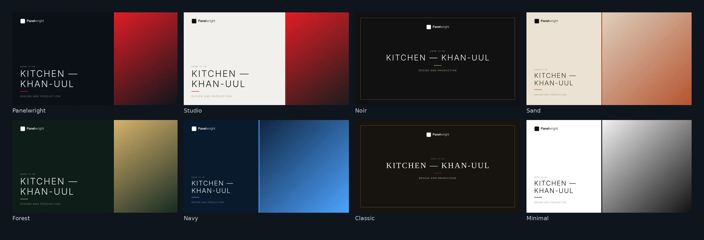

# Catalogue

From Panelwright 6.15 you can build a **landscape 16:9 PDF catalogue** from project images, the material palette and hardware. There are two kinds:

- **Project catalogue**: for one client, with that project's images and details.
- **Company catalogue**: a collection of your finished work to show new customers. It never contains prices.

Opening and building catalogues needs the "Add and delete project files and images" permission.

## Project catalogue

<figure class="docshot"><figcaption>Cover pages of the 8 catalogue templates.</figcaption></figure>

Press **📖 Catalogue** on the project card. Settings are on the left and small page previews on the right; the previews refresh as you change settings. Click a page to enlarge it.

Page order:

1. Cover: hero image, title, date, logo
2. Project details: client, project, date, area, sheets, parts, edge (and the total if you choose to include a price)
3. Design: the Render images (1, 2 or 3 images per page)
4. Finished work: the real photos
5. Materials: the material palette
6. Hardware: the hardware page
7. Working drawings: each dimensioned drawing as an engineering sheet, with a title, the drawing, a material list, and underneath the name, client, a date/code/area table, notes and the page number
8. Closing: contact details and logo

### Settings

- **Template**: *Panelwright* (dark) or *Studio* (light paper colour). All text is thin and in CAPITAL LETTERS.
- **Colour**: a colour picker, presets, or "Pick from logo".
- **Logo**: press "Choose logo / crop from catalogue", pick an image or a PDF (an old catalogue or document) and draw a rectangle around your logo. The white background is removed automatically. Save it once and it is used in every catalogue. Logo colour can be Original, White or Black.
- **Text**: title, tagline and description.
- **Images**: tick the Render, real and dimensioned images you want and reorder them with ↑↓. By default Render, real photos and drawings are included and "Other" is not.
- **Material palette**: chosen from the project's materials; if you uploaded an image for a material on the Prices page it appears as the swatch. You can add or remove entries.
- **Hardware**: the same way, from the images on the Hardware page.
- **Price**: left out by default. You may include the total, and it appears only for someone allowed to see prices.

Press **Create PDF** and the file is saved in the **Catalogue** category of the project card.

## Company catalogue

On the **Catalogue** tab in the left menu, tick the projects you want in the catalogue. From them Panelwright builds a cover, "About us", each project's hero image and real photos, all materials, all hardware and a closing page. Title, colour, template and the "About us" text are set once for the whole company. The PDF is saved in the `Компанийн_каталог` folder next to the registry and opens in your PDF viewer.

### When a job is finished

When a project reaches the **Completed** status, Panelwright asks once: "Add to the catalogue?" If you say yes, the project joins the company catalogue, and images and hardware you add afterwards are included automatically next time. You can change this at any moment with the "Add to the company catalogue" tick in the project catalogue window.

## Please note

- Pages go into the PDF as images, so the text inside the PDF cannot be selected or searched.
- Only the first page of a dimensioned PDF drawing is used.
- Images over 15 MB and PDFs over 25 MB are not included.
- A project with many images can take a few tens of seconds to prepare.
