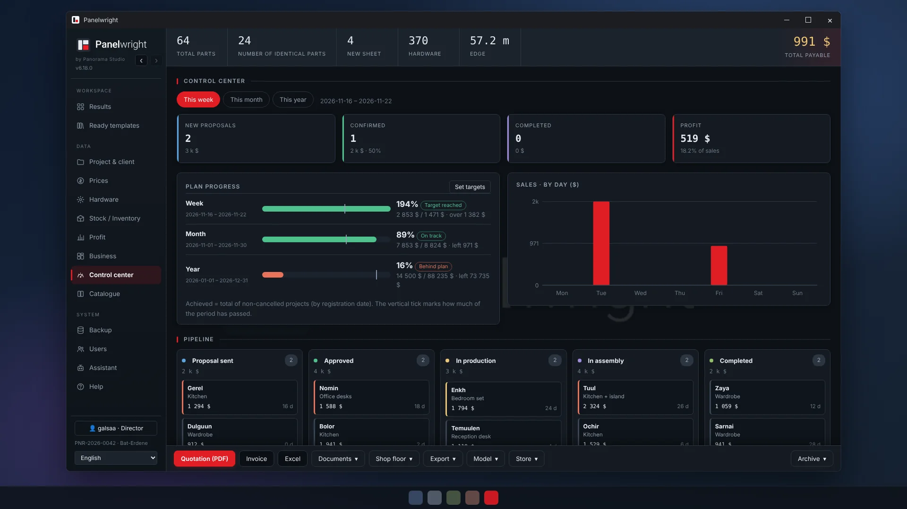
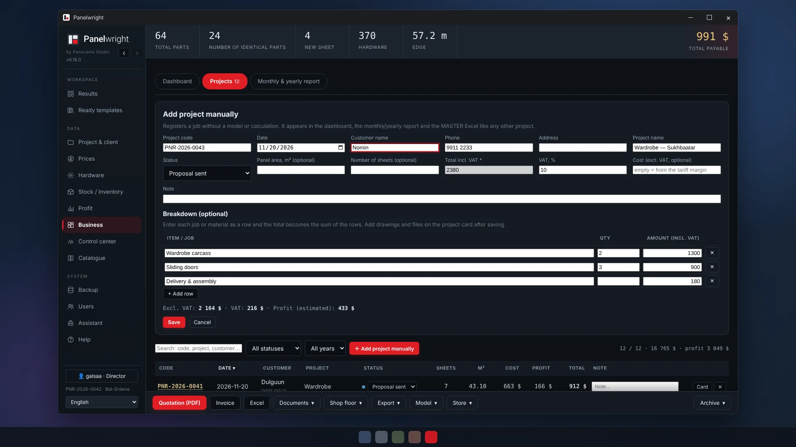

# Control center and project card

This page describes the **Control center** and the **project card**, added in Panelwright 6.13 and later.

## Control center

<figure class="docshot"><figcaption>The control center, shown with sample data.</figcaption></figure>

Open the **Control center** tab in the left menu. It is built from the jobs registered in the **Business** table, so it is only as current as your archive and statuses.

- **Figures:** new proposals, confirmed and completed jobs, sales and profit (as a share of sales).
- **Period:** switch between week, month and year. Sales are charted by month or by day.
- **Plan:** under "Set targets" enter your weekly, monthly and yearly targets to see progress against them.
- **Pipeline:** job cards are laid out in columns by status (proposal sent, confirmed, in assembly, completed, cancelled). Click a card to open the project card.
- **Overdue jobs** and the **workload of each designer** (by the name that registered the project) are listed separately.

The dashboard is visible only to someone with the "Business and control center" permission ([Working as a team](team.html)). Profit figures appear only with the "See cost and profit" permission.

## Project card

Open the card from the project code in the Business table, the "Card" button on the Project and customer page, a job card in the Control center, or the Catalogue page.

The card shows customer, phone, address, project, date, revision, total, status, note and the revision history. Change the status and note right there.

### Project files and images

Below, the project's files are sorted into categories:

- **Render**: design images
- **Real photos**: photos of the finished work
- **Dimensioned drawings**: working drawings (PDF or image)
- **Other**
- **Catalogue**: the catalogues you have built ([Catalogue](catalogue.html))

Files are stored in a `Файлууд` folder inside the project folder, one sub-folder per category. If a project has no folder, they go to the `Төслийн_файлууд` folder next to the registry. To add files:

- the "Add file" or "Add whole folder" button
- **drag files** onto the card
- copy an image and paste it with **Ctrl+V**

Each file may be up to 150 MB. Other files already in the project folder (quotes, Excel files and so on) appear under the "Project folder" tab.

### Viewing images and PDFs

Click a thumbnail to open it inside Panelwright. A PDF is shown page by page, fitted to the window, with zoom. Images up to 15 MB and PDFs up to 25 MB are shown here; larger files open in your own program with the "↗" button.

**Back and forward:** the ‹ › buttons at the top of the left menu, Alt+←/→, Backspace and your mouse back button take you through the windows you have visited.

### Permissions

Adding and deleting files needs the "Add and delete project files and images" permission. When a team works from a shared folder, the files live in the project folder and are visible to everyone.

## Adding a project manually

For a job with no model, or one you finished earlier, use **Add project manually** in the **Business** tab. Fill in the customer, phone, project name, code, date and status, then use **Add row** to itemise the work: name, quantity and amount. When rows are entered the total is the sum of the rows; with no rows you type the total yourself. The project card shows the itemised rows, and the job counts in the Control center figures. You can edit a manually added project later with the ✎ button.

<figure class="docshot"><figcaption>The Add project manually form.</figcaption></figure>

