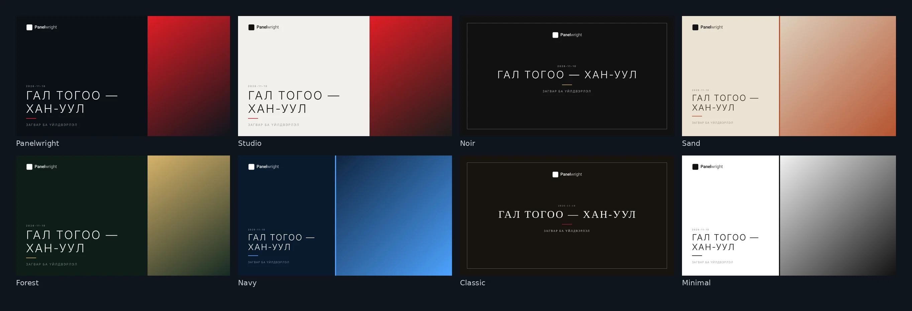

# Каталог

Panelwright 6.15-аас төслийн зураг, материалын палитр, тоноглолоос **хэвтээ 16:9 PDF каталог** гаргана. Хоёр төрөл бий:

- **Төслийн каталог**: тухайн захиалагчид зориулсан, тухайн төслийн зураг, мэдээлэл.
- **Компанийн каталог**: шинэ харилцагчид үзүүлэх, хийсэн ажлуудын цуглуулга. Үнэ хэзээ ч орохгүй.

Каталог нээх, гаргахад «Төслийн файл, зураг нэмэх/устгах» эрх хэрэгтэй.

## Төслийн каталог

<figure class="docshot"><figcaption>Каталогийн 8 загварын нүүр хуудас.</figcaption></figure>

Төслийн картын **📖 Каталог** товчийг дарна. Зүүн талд тохиргоо, баруун талд хуудсуудын жижиг зураг харагдах бөгөөд тохиргоо өөрчлөхөд шууд шинэчлэгдэнэ. Хуудас дээр дарж томруулна.

Хуудсуудын дараалал:

1. Нүүр: гол зураг, гарчиг, огноо, лого
2. Төслийн мэдээлэл: харилцагч, төсөл, огноо, талбай, хавтан, деталь, ирмэг (үнэ сонговол нийт дүн)
3. Дизайн: Render зургууд (хуудас бүрт 1, 2 эсвэл 3 зураг)
4. Бодит ажил: бодит зургууд
5. Материал: материалын палитр
6. Тоноглол: тоноглолын хуудас
7. Ажлын зураг: хэмжээтэй зураг бүрийг инженерийн хуудас хэлбэрээр: гарчиг, зураг, материалын жагсаалт, доор нэр, харилцагч, огноо/код/талбай хүснэгт, тэмдэглэл, хуудасны дугаар
8. Төгсгөл: холбоо барих мэдээлэл, лого

### Тохиргоо

- **Загвар**: *Panelwright* (хар) эсвэл *Studio* (цагаан-цаасан өнгө). Бүх бичиг нимгэн, ТОМ ҮСЭГТЭЙ.
- **Өнгө**: өнгөний сонгогч, бэлэн өнгөнүүд, эсвэл «Логоноос өнгө авах».
- **Лого**: «Лого, каталог сонгох / хайчлах» дарж зураг эсвэл PDF (хуучин каталог, баримт) сонгоод логогоо тэгш өнцөгтөөр хүрээлнэ. Цагаан дэвсгэрийг автоматаар арилгана. Нэг удаа хадгалахад бүх каталогт орно. Логоны өнгийг «Анхных», «Цагаан», «Хар» гэж сонгоно.
- **Текст**: гарчиг, дэд гарчиг, тайлбар.
- **Зураг**: Render, бодит, хэмжээтэй зураг бүрийг сонгож, ↑↓ товчоор дараалуулна. Анхдагчаар Render, бодит зураг, хэмжээтэй зураг орж, «Бусад» ангилал орохгүй.
- **Материалын палитр**: төслийн материалуудаас автоматаар сонгогдоно; «Үнэ ба тариф» хуудсанд материал бүрт зураг оруулсан бол дээж болж харагдана. Нэмж хасч болно.
- **Тоноглол**: адил зарчмаар «Тоноглол» хуудасны зургаас.
- **Үнэ**: анхдагчаар оруулахгүй. «Нийт дүнг оруулах»-ыг сонгож болох ба үнэ харах эрхтэй хүнд л гарна.

**PDF гаргах** дарахад файл төслийн картын **Каталог** ангилалд хадгалагдана.

## Компанийн каталог

Хажуугийн цэсний **Каталог** табаас каталогт оруулах төслүүдээ тэмдэглэнэ. Тэмдэглэсэн төслүүдээс нүүр, «Бидний тухай», төсөл бүрийн гол зураг ба бодит зургууд, нийт материал, нийт тоноглол, төгсгөл хуудас бүхий каталог бүтнэ. Гарчиг, өнгө, загвар, «Бидний тухай» текстийг бүх компанийн хэмжээнд нэг удаа тохируулна. PDF-ийг бүртгэлийн фолдер дахь `Компанийн_каталог` хавтсанд хадгалж, компьютерийн PDF үзэгчээр нээнэ.

### Ажил дуусахад

Төсөл **Дууссан** төлөвт орох үед «Каталогт нэмэх үү?» гэж нэг удаа асууна. «Тийм» гэвэл төсөл компанийн каталогт орж, дараа нь нэмсэн зураг, тоноглол дараагийн каталогт автоматаар орно. Төслийн каталогийн цонхны «Компанийн каталогт нэмэх» тэмдэглэгээгээр хэзээ ч өөрчилж болно.

## Анхаарах зүйл

- Хуудас нь зураг хэлбэрээр PDF-д орох тул PDF доторх бичвэрийг хуулах, хайх боломжгүй.
- Хэмжээтэй зургийн PDF-ийн зөвхөн эхний хуудас орно.
- Нэг зураг 15 МБ, PDF 25 МБ-аас том бол оруулахгүй.
- Зураг ихтэй төслийн каталогийг бэлтгэхэд хэдэн арван секунд орж болно.
