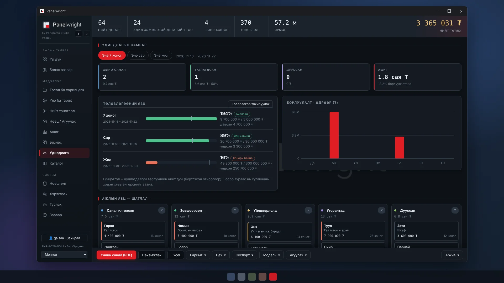
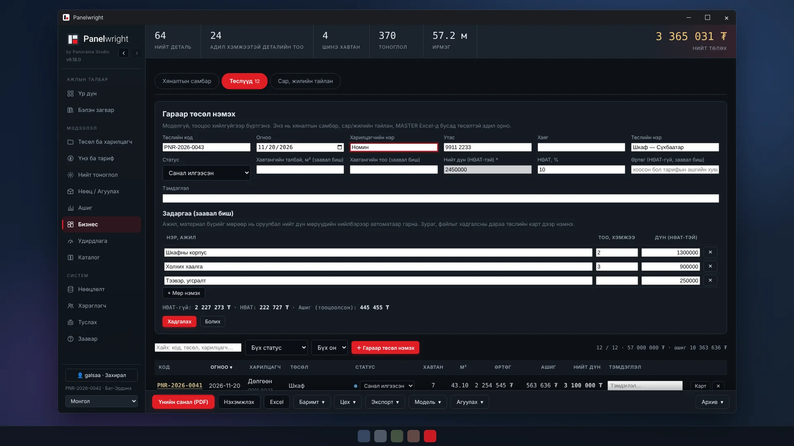

# Удирдлага ба төслийн карт

Энэ хуудас нь Panelwright 6.13-аас хойш нэмэгдсэн **Удирдлагын самбар** болон **төслийн карт**-ыг тайлбарлана.

## Удирдлагын самбар

<figure class="docshot"><figcaption>Удирдлагын самбар (жишээ мэдээлэлтэй).</figcaption></figure>

Хажуугийн цэсний **Удирдлага** табыг нээнэ. Энэ нь **Бизнес** хүснэгтэд бүртгэлтэй ажлуудаас бүрддэг тул ажлаа архивлаж, төлөвийг нь шинэчилж байх тусам үнэн зөв болно.

- **Тоон үзүүлэлт:** шинэ санал, батлагдсан, дууссан ажлын тоо, борлуулалт, ашиг (борлуулалтын хэдэн хувь нь).
- **Хугацаа:** 7 хоног, сар, жилээр сольж харна. Борлуулалтыг сараар эсвэл өдрөөр диаграмм болгоно.
- **Төлөвлөгөө:** «Төлөвлөгөө тохируулах» дээр 7 хоног, сар, жилийн зорилтоо оруулбал биелэлтийг харуулна.
- **Ажлын шатлал:** санал илгээсэн, батлагдсан, угсралтад, дууссан, цуцалсан гэсэн баганаар ажил бүрийн карт харагдана. Карт дээр дарахад төслийн карт нээгдэнэ.
- **Хоцорсон ажил** ба **дизайнер бүрийн ачаалал** (төслийг бүртгэсэн хүний нэрээр) тусдаа гарна.

Самбар зөвхөн «Бизнес, Удирдлагын самбар харах» эрхтэй хүнд харагдана ([Багаар ажиллах](team.html)). Ашгийн тоо зөвхөн «Өртөг, ашиг харах» эрхтэй хүнд гарна.

## Төслийн карт

Картыг дараах газраас нээнэ: Бизнес хүснэгтийн төслийн код, Төсөл ба харилцагч хуудасны «Карт» товч, Удирдлагын самбарын ажлын карт, Каталог хуудас.

Карт дээр харилцагч, утас, хаяг, төсөл, огноо, хувилбар, нийт дүн, төлөв, тэмдэглэл, хувилбарын түүх байна. Төлөв, тэмдэглэлийг эндээс шууд өөрчилнө.

### Төслийн файл, зураг

Картын доод хэсэгт төслийн файлууд ангиллаар харагдана:

- **Render**: дизайны зураг
- **Бодит зураг**: дууссан ажлын зураг
- **Хэмжээтэй зураг**: ажлын зураг (PDF эсвэл зураг)
- **Бусад**
- **Каталог**: гаргасан каталогууд ([Каталог](catalogue.html))

Файлууд төслийн фолдер доторх `Файлууд` хавтсанд ангилал тус бүрийн дэд хавтсаар хадгалагдана. Төслийн фолдер заагаагүй бол бүртгэлийн фолдер дахь `Төслийн_файлууд` хавтсанд хадгална. Файлыг нэмэх аргууд:

- «Файл нэмэх» эсвэл «Фолдероос бүгдийг нэмэх» товч
- Файлыг картан дээр **чирж оруулах**
- Зургийг хуулаад **Ctrl+V**-ээр буулгах

Файл бүр 150 МБ хүртэл байж болно. Төслийн фолдер дахь бусад файл (үнийн санал, Excel гэх мэт) «Төслийн фолдер» табд харагдана.

### Зураг, PDF үзэх

Жижиг зураг (thumbnail) дээр дарахад Panelwright дотор нээгдэнэ. PDF нь цонхонд таарах хэмжээгээр хуудас хуудсаар харагдаж, томруулж жижигрүүлнэ. Шууд харуулах хязгаар нь зураг 15 МБ, PDF 25 МБ бөгөөд үүнээс том файлыг «↗» товчоор компьютерийн өөрийн програмаар нээнэ.

**Буцах, урагш:** зүүн цэсний дээд талын ‹ › товч, Alt+←/→, Backspace, хулганы буцах товч нь өмнө үзсэн цонх руу шилжүүлнэ.

### Файл хуваалцах, эрх

Файл нэмэх, устгах нь «Төслийн файл, зураг нэмэх/устгах» эрхтэй хүнд л боломжтой. Багаар дундын фолдероор ажиллаж байвал файлууд нь төслийн фолдер дотор тул бүгдэд харагдана.

## Гараар төсөл нэмэх

Моделгүй ажил, өмнө нь хийсэн ажлаа **Бизнес** хэсгээс «＋ Гараар төсөл нэмэх» товчоор бүртгэнэ. Харилцагч, утас, төслийн нэр, код, огноо, статусыг бөглөөд, **мөр нэмэх** товчоор ажлыг мөр мөрөөр задлан бичнэ: нэр, тоо хэмжээ, дүн. Мөр оруулсан бол нийт дүн мөрүүдийн нийлбэрээс автоматаар гарна. Мөргүй бол нийт дүнг гараар бичнэ. Төслийн карт дээр мөрүүдийн задаргаа харагдана, бүртгэсэн ажил Удирдлагын самбарын тооцоонд ордог. Гараар нэмсэн төслийг ✎ товчоор хүссэн үедээ засна.

<figure class="docshot"><figcaption>Гараар төсөл нэмэх маягт.</figcaption></figure>

