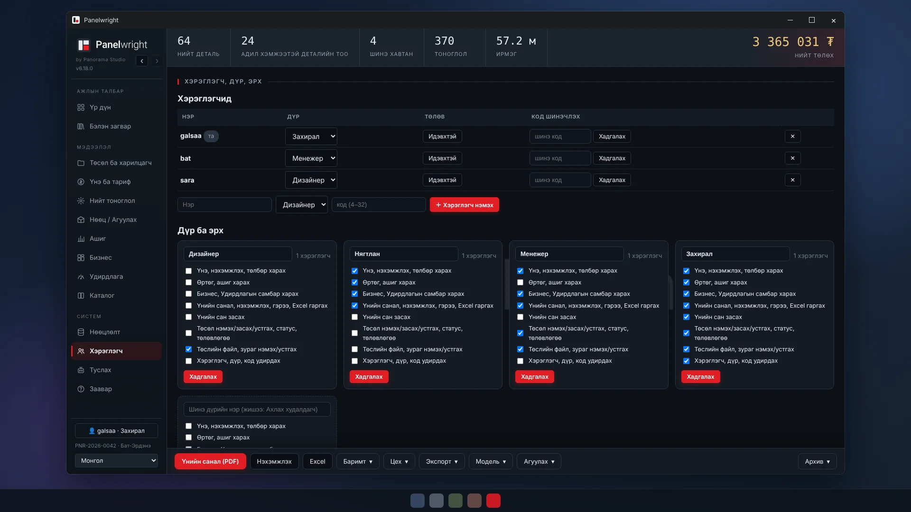

# Багаар ажиллах

Хэд хэдэн хүн нэг дундын фолдероор (сүлжээний диск эсвэл локал сервер) ажиллахад үнэ ба нийлүүлэгчийн сан, төслийн архив, үлдэгдэл, нөөц нэг газар байна. Panelwright 6.14-өөс эхлэн **хэрэглэгч, дүр, эрх**-ийн системтэй.

## Хэрэглэгчийн системийг эхлүүлэх

Хажуугийн цэсний **Хэрэглэгч** таб (санхүүгийн PIN тохируулсан бол эхлээд түүгээр түгжээг нээсэн байх ёстой) дээр өөрийн нэр, код (4–32 тэмдэгт) оруулж «Эхлүүлэх» дарна. Та **Захирал** дүрээр нэвтэрч, бүх эрхтэй болно. Хэрэглэгчдийн мэдээлэл үнийн сантай нэг фолдер дахь `Panelwright_хэрэглэгчид.json` файлд хадгалагдах тул бүх суудалд адилхан үйлчилнэ. Кодыг шууд бус, шифрлэсэн (давстай хэш) хэлбэрээр хадгална.

Дараа нь **Хэрэглэгч нэмэх** хэсэгт ажилтан бүрийн нэр, код, дүрийг оруулна. Кодыг «Код шинэчлэх»-ээр сольж, хэрэглэгчийг түр хаах эсвэл устгахыг ч эндээс хийнэ.

## Дүр ба эрх

<figure class="docshot"><figcaption>Хэрэглэгч, дүр, эрх (жишээ мэдээлэлтэй).</figcaption></figure>

Бэлэн дүрүүд (дүр бүрийн эрхийг өөрчилж, шинэ дүр нэмж болно):

| Дүр | Анхдагч эрх |
|---|---|
| Дизайнер | Төслийн файл, зураг нэмэх/устгах |
| Нягтлан | Үнэ, нэхэмжлэх харах; өртөг, ашиг; бизнес, удирдлагын самбар; үнийн санал, нэхэмжлэх, гэрээ, Excel гаргах |
| Менежер | Үнэ харах; бизнес, удирдлагын самбар; үнийн санал гаргах; төсөл нэмэх/засах/устгах, төлөв, төлөвлөгөө; файл |
| Захирал | Бүх эрх, хэрэглэгч удирдах |

Бүх эрхүүд: **үнэ, нэхэмжлэх, төлбөр харах**, **өртөг, ашиг харах**, **бизнес, Удирдлагын самбар харах**, **үнийн санал, нэхэмжлэх, гэрээ, Excel гаргах**, **үнийн сан засах**, **төсөл нэмэх/засах/устгах, төлөв, төлөвлөгөө**, **төслийн файл, зураг нэмэх/устгах**, **хэрэглэгч, дүр, код удирдах**.

Эрхгүй хүнд харгалзах таб, товч, тоо харагдахгүй. Жишээ нь «Өртөг, ашиг харах» эрхгүй хүнд Ашгийн таб болон өртөг, ашгийн тоо харагдахгүй, MASTER Excel гаргах боломжгүй.

## Нэвтрэх

Panelwright-ыг нээхэд (эсвэл «Нэвтрэх» товчоор) жагсаалтаас нэрээ сонгож, кодоо бичнэ. Зочин горим нь үнэ, ашиггүй харагдана. Таван удаа дараалан буруу код бичвэл 60 секунд түгжигдэнэ. Хэрэглэгчийн файл эвдэрвэл системд нэвтрэх боломжгүй болж, бүх мөнгөний мэдээлэл хаалттай үлдэнэ.

## Анхаарах зүйл

Эрх, код нь ажилтнууд **санамсаргүй** үнэ, ашиг харахаас сэргийлэх хамгаалалт. Үнийн мэдээлэл дундын фолдерт файл хэлбэрээр байдаг тул компьютер сайн мэддэг хүн фолдероос шууд нээж харж чадна. Үнэхээр нууц байх ёстой бол фолдерийн эрхийг сүлжээн дээрээ тусад нь хязгаарлана.

Хэрэглэгчийн системийг асаасны дараа хуучин ганц PIN-ийн оронд нэр, код ашиглана.
