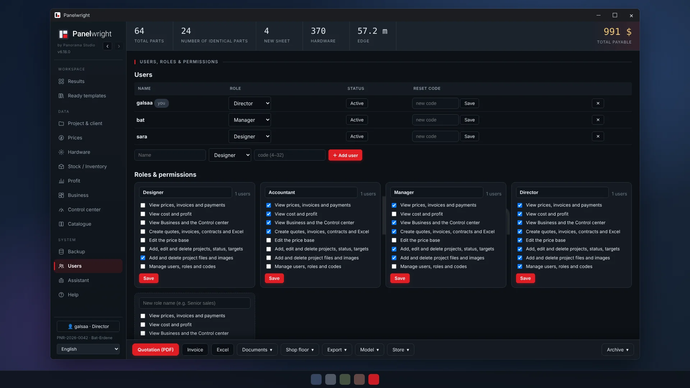

# Working as a team

When several people work from one shared folder (a network drive or a local server), the price and supplier database, the project archive, offcuts and stock all sit in one place. From Panelwright 6.14 there is also a system of **users, roles and permissions**.

## Turning on the user system

Open the **Users** tab in the left menu (if a finance PIN is set, unlock it first). Enter your name and a code (4–32 characters) and press "Enable". You are signed in as **Director** with every permission. The user data is stored in `Panelwright_хэрэглэгчид.json`, in the same folder as the price file, so it applies to every seat. Codes are stored as salted hashes, never in plain text.

Then add each employee under **Add user** with a name, a code and a role. You can reset a code, disable a user temporarily or delete one from the same tab.

## Roles and permissions

<figure class="docshot"><figcaption>Users, roles and permissions, shown with sample data.</figcaption></figure>

Ready-made roles (you can edit what each role may do and add roles of your own):

| Role | Default permissions |
|---|---|
| Designer | Add and delete project files and images |
| Accountant | See prices, invoices and payments; cost and profit; business and control center; produce quotes, invoices, contracts, Excel |
| Manager | See prices; business and control center; produce quotes; add, edit and delete projects, status, targets; files |
| Director | Everything, including managing users |

The full list of permissions: **see prices, invoices and payments**, **see cost and profit**, **see the Business and Control center**, **produce quotes, invoices, contracts and Excel files**, **edit the price list**, **add, edit and delete projects, status, targets**, **add and delete project files and images**, and **manage users, roles and codes**.

A person without a permission does not see the matching tab, button or number. For example, without "See cost and profit" the Profit tab and the cost and profit figures are hidden, and the MASTER Excel cannot be produced.

## Signing in

When you open Panelwright (or press "Sign in") pick your name from the list and type your code. Guest mode shows no prices or profit. Five wrong codes in a row lock the sign-in for 60 seconds. If the user file is damaged nobody can sign in, and all money information stays hidden.

## Please note

Permissions and codes protect against colleagues **seeing prices and profit by accident**. The price data sits in the shared folder as a file, so someone technically skilled could open it directly. If something must be truly secret, restrict folder permissions on your network as well.

Once the user system is on, names and codes replace the old single PIN.
